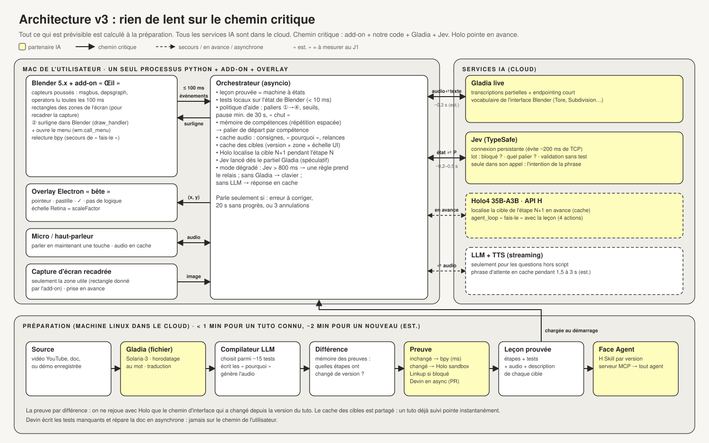

# Architecture



Cas d'usage pas à pas : [docs/schemas/cas-usage.svg](docs/schemas/cas-usage.svg) · justification de chaque optimisation : [docs/optimisations-v3.md](docs/optimisations-v3.md).

## 1. Principe
**Rien de lent ni de fragile sur le chemin critique.**
- Tout ce qui est prévisible (tests, « pourquoi », audio, descriptions des cibles) est calculé **à la préparation**.
- En direct, le chemin critique d'une réussite passe par l'add-on et notre code ; Gladia et Jev interviennent pour la voix et l'ambiguïté.
- Holo (API H) pointe **en avance** : il localise la cible de l'étape N+1 pendant que l'utilisateur fait l'étape N.

Règle de décision : **le code valide ce qui est sûr, Jev tranche l'ambigu, Holo voit et agit.**

## 2. Les trois blocs

### A. Préparation (`prep/`), sur une machine Linux dans le cloud, une fois par tuto et par version
```
source (vidéo / doc / démo) → Gladia (fichier) → compilateur Holo LLM → différence de version → preuve → leçon prouvée → face Agent
```
| Étape | Ce qu'elle fait | Brique |
|---|---|---|
| transcription | texte horodaté au mot, vocabulaire de l'interface Blender, traduction FR→EN | Gladia |
| compilation | découpe en étapes ; chaque étape **choisit** un test dans la bibliothèque (~15 tests) au lieu d'écrire du code ; écrit le « pourquoi » ; génère l'audio | Holo LLM + TTS (fournisseur ouvert) |
| différence | carte des menus de chaque version + mémoire des preuves : quelles étapes ont changé depuis la version du tuto ? | notre code |
| preuve | inchangé → exécution `bpy` directe (millisecondes) ; changé → Holo rejoue le chemin d'interface en sandbox (`engine/services/holo`) ; bloqué → Linkup (`prep/docs_search`) ; pas de test → Devin (`prep/repair`, en asynchrone) | Holo, Linkup, Devin |
| export | H Skill, une révision par version ; serveur MCP (`agent/`) | H |

Résultat : `lessons/<id>/lesson.json` + l'audio en cache. Objectif : moins d'1 min (est.) pour un tuto déjà connu, environ 2 min (est.) pour un nouveau court.

### B. Direct, sur le poste de l'utilisateur
Un seul processus Python asyncio (`engine/`) et deux clients :
- **`addon/`** (dans Blender) : il **pousse** des événements (opérateurs exécutés, changements de scène, mode, sélection, rectangles des zones de l'écran). Il exécute les ordres : surligner une zone (`draw_handler`), ouvrir un menu (`wm.call_menu`), rejouer en `bpy`.
- **`desktop/`** (Tauri v2) : il affiche le pointeur, la pastille et le ✓ ; son backend Rust gère fenêtres, capture, permissions, hotkey, enigo et sidecar, sans logique pédagogique.

Dans `engine/` :
| Module | Rôle |
|---|---|
| `bus/` | bus d'événements, serveurs socket (add-on) et WebSocket (desktop) |
| `lesson/` | machine à états de la leçon en cours |
| `checks/` | bibliothèque de tests sur l'état de Blender (< 10 ms, est.) |
| `policy/` | paliers d'aide ①→④, seuils, pause de 30 s, « chut », quand parler |
| `learner/` | mémoire de compétences (répétition espacée) → palier de départ |
| `cache/` | audio, cibles Holo (version × zone × échelle UI × cible) |
| `services/` | clients cloud : Gladia live, Jev, Holo, LLM + TTS |
| `fallback/` | mode dégradé (Jev > 800 ms → une règle ; sans Gladia → clavier ; sans LLM → cache) |
| `platform/` | spécificités macOS / Windows (permissions, échelle de l'écran, capture) |
| `debug/` | page web locale qui montre en direct événements, décisions et latences |

### C. Services IA (cloud)
| Service | Appel | Sur le chemin critique ? |
|---|---|---|
| Gladia live | audio → texte partiel puis final | oui (~0,3 s, est.) |
| Jev | état + question → choix + probabilité ; connexion persistante ; questions simples groupées, l'intention seule dans son appel ; lancé dès le partiel | oui (mesures publiques laptop ~460–560 ms, pas notre réseau) |
| Holo4 35B-A3B (API H) | capture recadrée + description → (x, y), **en avance** ; `agent_loop` pour « fais-le » | non (en avance) |
| LLM + TTS | questions hors script, en streaming | non (secours) |

## 3. Quand le prof parle
Par défaut, un ✓ silencieux. Il ne parle spontanément que si l'erreur est à corriger, après 20 s sans progrès, ou après 3 annulations d'affilée. Au moins 30 s entre deux interventions, et « chut » le fait taire.

Paliers : ① indice à la voix → ② zone surlignée dans Blender → ③ pointeur exact (Holo) → ④ démo (3 à 5 s de la vidéo de preuve, ou action faite dans Blender puis annulée).

## 4. Contrats (`contracts/`), figés en premier
1. **Leçon** : étapes, test, cible (description, pas de coordonnées), « pourquoi », audio, erreurs connues.
2. **Événements de l'add-on** : opérateur, changement de scène, mode, sélection, zones, version de Blender.
3. **Ordres** : surligner, ouvrir un menu, rejouer, pointer, dire, ✓.

Les contrats permettent aux trois personnes de l'équipe d'avancer en parallèle.

## 5. Répartition à trois
| Personne | Dossiers |
|---|---|
| A · préparation | `prep/`, `lessons/`, `engine/checks/` |
| B · cerveau en direct | `engine/` (hors `services/holo`), `addon/` |
| C · interface | `desktop/`, `engine/services/holo`, voix, pitch |

## 6. Ce qui peut casser, et le secours
| Risque | Secours |
|---|---|
| Holo trop lent ou réseau faible | zone surlignée + raccourci clavier ; partage de connexion 4G |
| Jev au-delà de 800 ms | une règle prend le relais |
| Action invisible dans `operators` (opérateurs non `REGISTER`) | on la voit dans l'état de la scène (`depsgraph`) |
| Permissions macOS / Windows | écran de vérification au premier lancement |


## Conception détaillée et statut
La référence d'implémentation est l'[index du design](docs/README.md). Desktop est une app Tauri v2 : Rust possède deux fenêtres, capture avec exclusion explicite, injection enigo, permissions et sidecar Python ; web reste sans politique pédagogique. Tous les services IA sont cloud, Holo sert aussi de LLM. TTS reste ouvert : Gladia ne synthétise pas la voix. Les inventaires décrivent notre code existant porté à adapter, pas du code déjà livré ici. Les durées sont des objectifs (est.) sauf les mesures publiques explicitement identifiées. Les schémas SVG historiques sont conservés sans régénération ; les documents détaillés et ADR font foi en cas d'écart.
