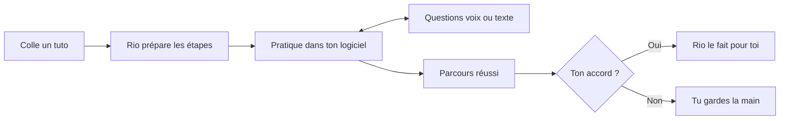
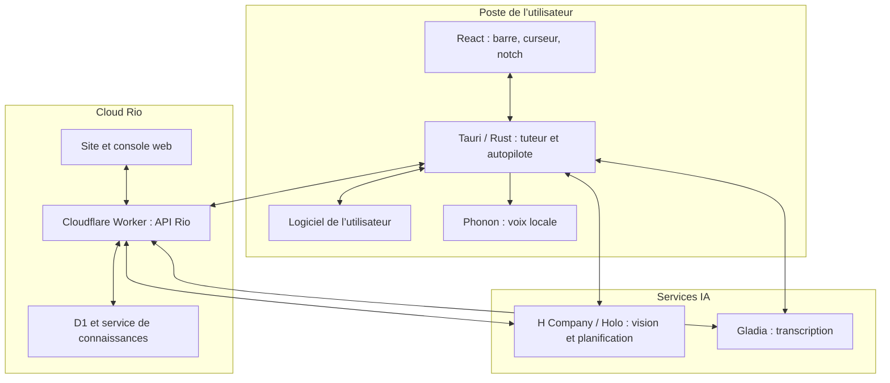

<div align="center">

<picture>
  <source media="(prefers-color-scheme: dark)" srcset="brand/rio-mark-white.svg">
  
</picture>

# Rio

### Arrête de jongler entre le tuto et ton logiciel.

Colle un tutoriel. Rio te guide dans ton application, répond à tes questions et peut refaire la tâche avec ton accord.

[](https://rio.vignemale.com)
[](#installation)
[](https://rio.vignemale.com/home)

**Le site pour découvrir Rio. La console pour ton équipe. L’application pour apprendre dans ton logiciel.**

L’application de bureau se lance depuis les sources ; un installeur en un clic est prévu.

</div>

## Problématique

Un tutoriel montre une procédure. Il ne voit pas où tu bloques dans Blender, DaVinci Resolve ou ton outil interne.

| Aujourd’hui | Avec Rio |
|---|---|
| Pause, retour arrière, changement de fenêtre. | Des indications superposées à ton logiciel. |
| Le menu n’est plus au même endroit. | Un guidage à partir de ce qui est visible à l’écran. |
| Tu bloques sans comprendre pourquoi. | Des questions en texte ou à voix haute, pendant la leçon. |
| La même tâche revient la semaine suivante. | Un parcours réussi réutilisable, à déléguer avec ton accord. |

## Solution



1. **Prépare.** Un lien YouTube, une page web, un tutoriel de la bibliothèque ou ton objectif devient une leçon en étapes.
2. **Pratique.** Une barre flottante et un curseur superposé montrent où agir ; Rio suit ta progression à l’écran.
3. **Demande.** Écris ou parle pendant la leçon : Rio répond et garde le contexte. La voix nécessite une configuration supplémentaire.
4. **Délègue.** Après une leçon réussie, la barre en haut de l’écran propose « Rio le fait pour toi ». Tu acceptes ou refuses, tu peux arrêter ; Rio vérifie le résultat avant d’annoncer la réussite.
5. **Partage.** La [console d’équipe](https://rio.vignemale.com/home) réunit tutoriels, connaissances, membres et statistiques d’utilisation.

L’application vise macOS. L’autopilote fonctionne aussi sous Linux X11 ; Wayland est explicitement refusé. La précision du pointage et les demandes vagues restent des limites : Rio ne garantit pas la réussite de toute tâche.

## Architecture



Le tuteur organise une leçon en **jalons vérifiables à l’écran**, pas en coordonnées fixes. Holo analyse les captures pour guider l’utilisateur. L’autopilote réutilise ces jalons et contrôle leur résultat sur de nouvelles captures. Certains parcours réussis peuvent aussi être compilés en scripts testés via Devin.

### Organisation du dépôt

| Dossier | Rôle et documentation |
|---|---|
| [`src/`](src/) | Interface React/TypeScript : barre de commande, curseur et notch. |
| [`src-tauri/`](src-tauri/) | Application native Rust/Tauri : tuteur, capture, voix et autopilote. |
| [`landing/`](landing/) | Site public [rio.vignemale.com](https://rio.vignemale.com). [Guide du site](landing/README.md). |
| [`platform/`](platform/) | Worker Cloudflare, API, console et D1. [Installation et API](platform/README.md). |
| [`platform/knowledge/`](platform/knowledge/) | Service de recherche dans la base de connaissances. |
| [`tutorials/`](tutorials/) | Tutoriels d’exemple sous forme de graphes de jalons. |
| [`sim/`](sim/) | Scénarios et applications de test. [Guide du simulateur](sim/README.md). |
| [`tools/`](tools/) | Outils, dont l’explorateur des journaux de session. |
| [`demo/`](demo/) | Préparation des démonstrations et installation de skills d’exemple. |
| [`brand/`](brand/) | Logos et visuels Rio. |
| [`.prime/agent/skills/rio-harness-core/`](.prime/agent/skills/rio-harness-core/) | [Guide technique pour les agents](.prime/agent/skills/rio-harness-core/SKILL.md), invariants et scripts de validation. |

### Services et recherche web

H Company fournit la vision et la planification, Gladia transcrit voix et vidéos YouTube, et Phonon synthétise la voix localement. Cloudflare héberge le site, la console et l’API.

<a id="web-search-h-agents-and-linkup"></a>

- **Pendant une leçon** : base de connaissances de l’équipe, puis Linkup si configuré ; sans résultat, Holo peut répondre à partir de ses connaissances, avec cette origine signalée.
- **Tutoriel créé depuis un objectif** : agent H `h/deep-search-pro`, puis Linkup en secours.
- **Page web collée** : texte de la page ; l’agent H `h/web-surfer-pro` intervient si le contenu est insuffisant.
- **Lien YouTube** : transcription Gladia, puis préparation des étapes par Holo.

### Validation et journaux

Le [simulateur d’apprenant](sim/README.md) exécute le vrai tuteur dans un Chrome sans interface, avec des profils et des erreurs rejouables. Des contrôles de l’état réel de l’application notent le résultat et repèrent les réussites annoncées à tort. Ces évaluations complètent les tests Rust ; elles ne prouvent pas une fiabilité universelle.

Pour explorer les sessions locales :

```bash
python3 tools/session_explorer.py --open
```

Les journaux dans `sessions/` contiennent des captures de l’écran : ils ne doivent pas être publiés sans vérification.

## Installation

### Application de bureau — macOS

Prérequis : [Node.js](https://nodejs.org) **22.12 ou plus récent**, [Rust](https://rustup.rs) et les outils Apple (`xcode-select --install`).

```bash
git clone https://github.com/talal95c/Hcompany-Hack.git
cd Hcompany-Hack
cp .env.example .env
```

Renseigne `HAI_API_KEY` dans `.env` avec une [clé H Company](https://platform.hcompany.ai/settings/api-keys), puis lance Rio :

```bash
npm install
npm run tauri dev
```

Dans **Réglages Système → Confidentialité et sécurité**, autorise le terminal pour l’enregistrement de l’écran, l’accessibilité et la surveillance de l’entrée. Ajoute l’autorisation microphone pour la voix, puis redémarre Rio.

Ouvre la barre avec **⌥ ⇧ Espace** ou l’icône de la barre des menus. Décris ton objectif ou colle un lien de tutoriel, puis suis le curseur.

Options dans [`.env.example`](.env.example) :
- `GLADIA_API_KEY` active la transcription vocale ;
- `HF_TOKEN` donne accès à [Phonon 40m](https://huggingface.co/gradium/phonon-40m-multilingual), après acceptation des conditions ; sans accès, Rio utilise le modèle public 31m. Les poids Phonon sont sous licence non commerciale CC BY-NC 4.0 ;
- `RIO_API_URL=https://rio.vignemale.com` et `RIO_API_TOKEN` relient l’application à l’équipe ; le jeton se crée dans **Settings** sur la console ;
- `LINKUP_API_KEY` ajoute la recherche web de secours.

### Développement web

Pour travailler uniquement sur le site :

```bash
cd landing
npm install
npm run dev
```

Pour la console, l’API et les migrations locales, suivre le [guide de la plateforme](platform/README.md#run-it-locally). Les clés restent dans les fichiers locaux ignorés par Git ou dans les secrets Cloudflare.

### Vérifications

Depuis la racine, `npm run build` vérifie TypeScript et construit l’interface. Les tests natifs se lancent avec `cd src-tauri && cargo test`. Les tests web et de simulation sont détaillés dans les guides de la [plateforme](platform/README.md) et du [simulateur](sim/README.md).
