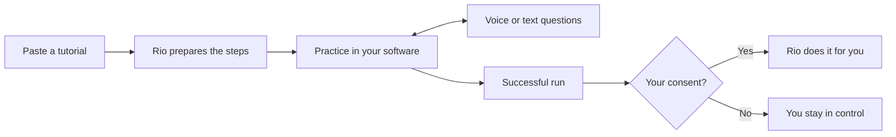
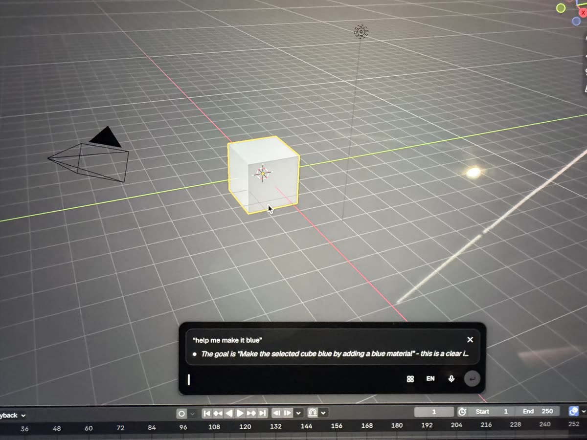
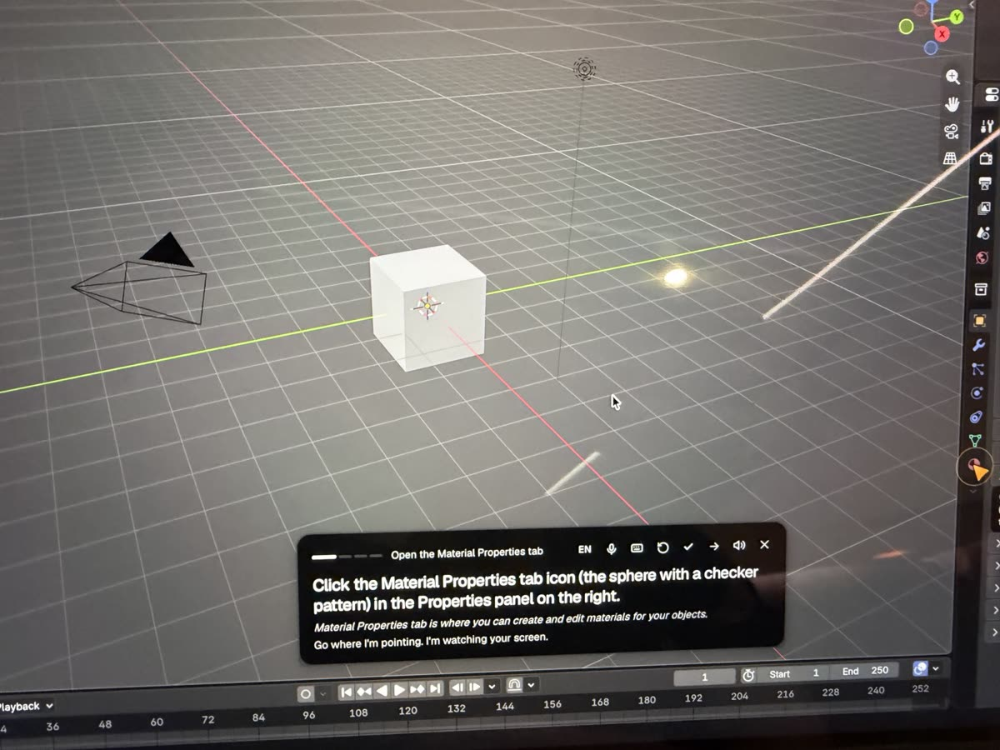
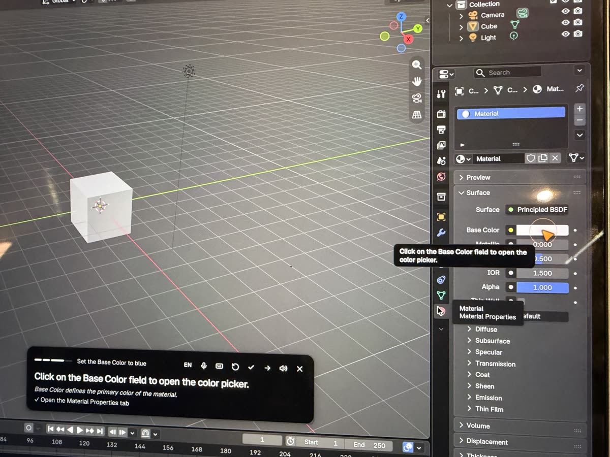
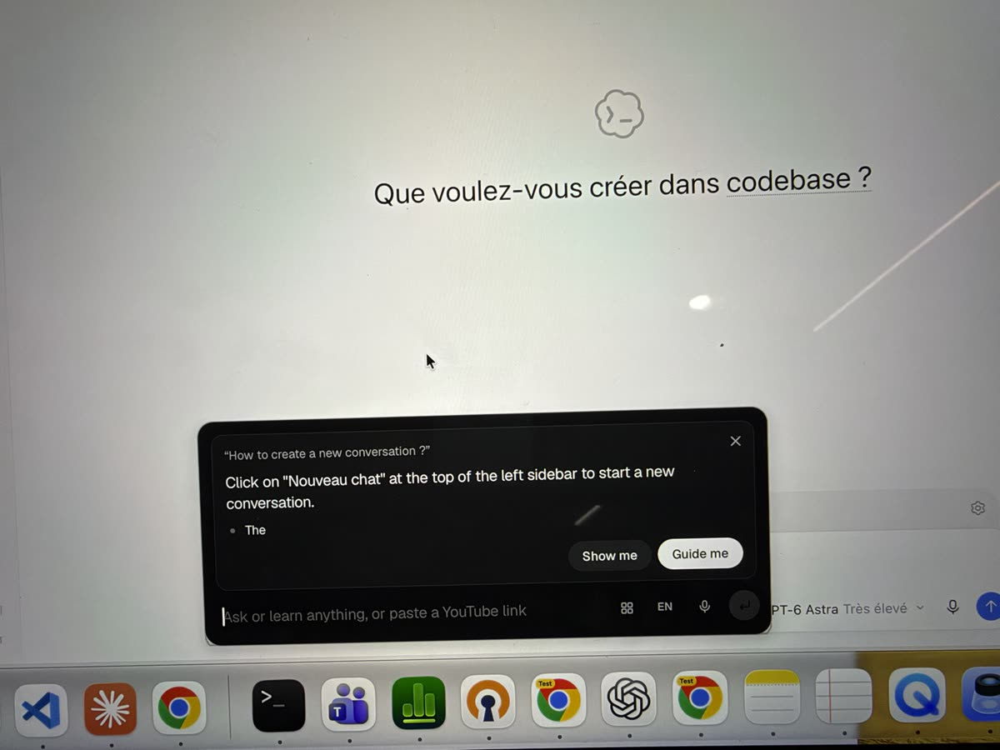
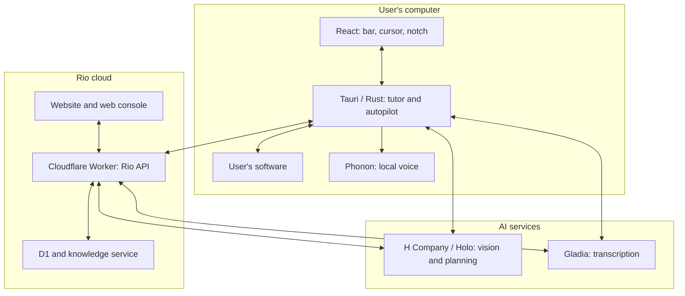

<div align="center">


### Stop juggling between the tutorial and your software.

Paste a tutorial. Rio guides you inside your application, answers your questions and can do the task again for you, with your consent.

[](https://rio.vignemale.com)
[](#installation)
[](https://rio.vignemale.com/home)

**The website to discover Rio. The console for your team. The app to learn inside your software.**

The desktop app runs from source; a one-click installer is planned.

</div>

## Problem

A tutorial shows a procedure. It cannot see where you get stuck in Blender, DaVinci Resolve or your internal tool.

| Today | With Rio |
|---|---|
| Pause, rewind, switch windows. | Guidance overlaid on your software. |
| The menu is no longer where the video shows it. | Guidance based on what is actually on screen. |
| You get stuck without knowing why. | Ask questions by text or voice, during the lesson. |
| The same task comes back the following week. | A successful run you can reuse and delegate, with your consent. |

## Solution



1. **Prepare.** A YouTube link, a web page, a tutorial from the library or your goal becomes a step-by-step lesson.
2. **Practice.** A floating bar and an overlaid cursor show where to act; Rio follows your progress on screen.
3. **Ask.** Type or speak during the lesson: Rio answers and keeps the context. Voice requires extra setup.
4. **Delegate.** After a successful lesson, the bar at the top of the screen offers “Rio does it for you”. You accept or decline, and you can stop it at any time; Rio checks the result before reporting success.
5. **Share.** The [team console](https://rio.vignemale.com/home) brings together tutorials, knowledge, members and usage statistics.

The app targets macOS. The autopilot also works on Linux X11; Wayland is explicitly refused. Pointing accuracy and vague requests remain limitations: Rio does not guarantee that every task will succeed.

### In practice

Photos taken on a Mac during a real session. The orange cursor and the bubbles come from Rio; the learner does the clicks.

| 1. Ask in plain words | 2. Rio points to the next step |
|---|---|
|  |  |
| The learner types “help me make it blue”. Rio turns it into a goal: make the selected cube blue with a material. | Each step has one instruction, the reason behind it, and a cursor on the right button. |
| **3. The next step after a check** | **4. Any app, not only Blender** |
|  |  |
| Rio sees that the material tab is open, ticks the step, then points to Base Color. | Asked how to start a new conversation, Rio answers and offers “Show me” or “Guide me”. |

## Architecture



The tutor organizes a lesson into **milestones that can be checked on screen**, not fixed coordinates. Holo analyzes screenshots to guide the user. The autopilot reuses these milestones and checks their outcome on fresh screenshots. Some successful runs can also be compiled into tested scripts through Devin.

### Repository layout

| Folder | Role and documentation |
|---|---|
| [`src/`](src/) | React/TypeScript interface: command bar, cursor and notch. |
| [`src-tauri/`](src-tauri/) | Native Rust/Tauri app: tutor, capture, voice and autopilot. |
| [`landing/`](landing/) | Public website [rio.vignemale.com](https://rio.vignemale.com). [Website guide](landing/README.md). |
| [`platform/`](platform/) | Cloudflare Worker, API, console and D1. [Setup and API](platform/README.md). |
| [`platform/knowledge/`](platform/knowledge/) | Knowledge base search service. |
| [`tutorials/`](tutorials/) | Sample tutorials as milestone graphs. |
| [`sim/`](sim/) | Test scenarios and applications. [Simulator guide](sim/README.md). |
| [`tools/`](tools/) | Tools, including the session log explorer. |
| [`demo/`](demo/) | Demo preparation and sample skill installation. |
| [`brand/`](brand/) | Rio logos and visuals. |
| [`.prime/agent/skills/rio-harness-core/`](.prime/agent/skills/rio-harness-core/) | [Technical guide for agents](.prime/agent/skills/rio-harness-core/SKILL.md), invariants and validation scripts. |

### Services and web search

H Company provides vision and planning, Gladia transcribes voice and YouTube videos, and Phonon synthesizes speech locally. Cloudflare hosts the website, the console and the API.

<a id="web-search-h-agents-and-linkup"></a>

- **During a lesson**: the team's knowledge base, then Linkup if configured; with no result, Holo can answer from its own knowledge, and says so.
- **Tutorial created from a goal**: H agent `h/deep-search-pro`, with Linkup as a fallback.
- **Pasted web page**: the page's text; the H agent `h/web-surfer-pro` steps in if the content is not enough.
- **YouTube link**: Gladia transcription, then Holo prepares the steps.

### Validation and logs

The [learner simulator](sim/README.md) runs the real tutor in a headless Chrome, with replayable profiles and mistakes. Checks on the app's actual state score the outcome and flag successes that were wrongly reported. These evaluations complement the Rust tests; they do not prove universal reliability.

To explore local sessions:

```bash
python3 tools/session_explorer.py --open
```

Logs in `sessions/` contain screenshots: do not publish them without checking them first.

## Installation

### Desktop app — macOS

Requirements: [Node.js](https://nodejs.org) **22.12 or later**, [Rust](https://rustup.rs) and the Apple developer tools (`xcode-select --install`).

```bash
git clone https://github.com/talal95c/Hcompany-Hack.git
cd Hcompany-Hack
cp .env.example .env
```

Set `HAI_API_KEY` in `.env` to an [H Company key](https://platform.hcompany.ai/settings/api-keys), then start Rio:

```bash
npm install
npm run tauri dev
```

In **System Settings → Privacy & Security**, allow your terminal for Screen Recording, Accessibility and Input Monitoring. Add Microphone access for voice, then restart Rio.

Open the bar with **⌥ ⇧ Space** or the menu bar icon. Describe your goal or paste a tutorial link, then follow the cursor.

Options in [`.env.example`](.env.example):
- `GLADIA_API_KEY` enables voice transcription;
- `HF_TOKEN` gives access to [Phonon 40m](https://huggingface.co/gradium/phonon-40m-multilingual) once you accept its terms; without access, Rio uses the public 31m model. Phonon weights are under the non-commercial CC BY-NC 4.0 license;
- `RIO_API_URL=https://rio.vignemale.com` and `RIO_API_TOKEN` connect the app to your team; create the token in **Settings** in the console;
- `LINKUP_API_KEY` adds fallback web search.

### Web development

To work on the website only:

```bash
cd landing
npm install
npm run dev
```

For the console, the API and local migrations, follow the [platform guide](platform/README.md#run-it-locally). Keys stay in local files ignored by Git or in Cloudflare secrets.

### Checks

From the repository root, `npm run build` type-checks TypeScript and builds the interface. Run the native tests with `cd src-tauri && cargo test`. Web and simulation tests are described in the [platform](platform/README.md) and [simulator](sim/README.md) guides.
