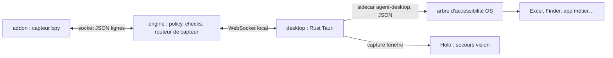

# Accessibilité native — capteur générique hors Blender (proposition)

Statut : proposition, rien n'est implémenté. Décision associée : [ADR 0011](../decisions/0011-accessibilite-native.md). Explication non technique : [extension aux apps natives](../extension-apps-natives.md).

## Problème
Pour Blender, l'[add-on](addon.md) est le capteur : il donne l'état exact (bpy) et les rectangles des régions, et Holo localise sur capture. Pour Excel, Word, Finder, Réglages ou une app métier, il n'y a pas d'add-on. Aujourd'hui il ne reste que la capture + Holo, sans vérification d'état : on ne peut pas prouver un ✓ (« pas de ✓ sans check récent »).

Les OS exposent déjà l'interface de la plupart des apps aux lecteurs d'écran : un **arbre d'accessibilité** (rôle, nom, valeur, état, rectangle de chaque élément). C'est l'équivalent générique de l'add-on.

| OS | API native |
|---|---|
| macOS | AX API (même permission Accessibilité que celle déjà demandée par desktop) |
| Windows | UI Automation |
| Linux | AT-SPI (bus D-Bus) |

## Brique retenue : agent-desktop
[vercel-labs/agent-desktop](https://github.com/vercel-labs/agent-desktop) : binaire Rust, licence Apache-2.0, CLI à sortie JSON, bibliothèque C et serveur MCP (`agent-desktop mcp`). Aucun modèle embarqué : il observe et agit, la décision reste chez nous. Version examinée : 1.2.0.

| Besoin | Commande agent-desktop |
|---|---|
| Observer | `snapshot --app <app> -i --compact --include-bounds` ; `--skeleton` puis `--root <ref>` pour les apps denses |
| Chercher une cible | `find` (rôle, nom, valeur, texte) |
| Vérifier | `get --property value\|text\|states\|bounds`, `is` (enabled, checked, focused…), `wait --text/--element/--predicate value` |
| Agir | `click`, `set-value`, `type`, `select`, `toggle`, `check`, `expand`, `press` ; livraison sémantique par défaut, entrée physique seulement avec `--headed` |
| Écran | `list-displays` (bornes, facteur d'échelle), `screenshot` d'une fenêtre pour le secours Holo |
| Traçabilité | `--trace <fichier.jsonl>` |

Chaque élément reçoit une référence `@<snapshot_id>:eN` valable pour **ce snapshot uniquement**. Erreurs à traiter explicitement : `APP_NOT_FOUND`, `STALE_REF` (l'interface a changé), `AMBIGUOUS_TARGET` (plusieurs candidats), `POLICY_DENIED`, arbre incomplet (`complete: false`).

## Où ça se branche
Les règles du dépôt sont conservées : engine décide, desktop possède les accès natifs, aucune injection native hors de desktop.

| Composant | Rôle proposé |
|---|---|
| `desktop/src-tauri/` | lance `agent-desktop` comme sidecar (binaire épinglé, `externalBin` Tauri), relaie snapshots, `get` et actions ; applique les mêmes garde-fous que `input.rs` (consentement, verrou, stop prioritaire, focus de l'app cible) |
| `contracts/desktop-ws.schema.json` | nouveaux messages additifs : `a11y.snapshot` / `a11y.get` / `a11y.action` (engine → desktop), `a11y.result` (desktop → engine) avec `snapshot_id`, `complete`, arbre filtré, erreur typée |
| `engine/platform/` | conversion des `bounds` (points logiques) vers les repères existants ; aucune capture ni injection Python |
| `engine/` (routeur) | choisit le capteur par app : add-on pour Blender, arbre si `complete` et cible unique, sinon Holo sur capture de la fenêtre |
| `engine/checks/` | nouveaux checks déterministes sur l'arbre : `element_exists`, `element_value`, `element_state` (paramètres fermés, pass/fail/unknown) |
| `prep/ui_map/` | carte UI d'une app native construite depuis un snapshot (rôles, noms, chemins) au lieu de l'AST des menus Blender |
| `contracts/lesson.schema.json` | à terme : champ `app` + `app_version` à côté de `blender_version` ; changement de contrat versionné, hors périmètre actuel |
| `agent/` | `list_apps` renvoie aujourd'hui seulement `blender` ; il listerait les apps dont une leçon est prouvée |
| `bench/` | suite `a11y` : succès, latence et taille de contexte arbre vs capture + Holo, taux de secours vision |

## Cibles : décrire, puis résoudre à chaque fois
Conforme à l'[ADR 0010](../decisions/0010-cibles-descriptives.md) : la leçon stocke une description (`role`, `name`, chemin d'ancêtres, texte attendu), jamais une ref ni des pixels. En direct : snapshot frais → `find` → ref unique → action → nouveau snapshot. `STALE_REF` relance une seule résolution ; `AMBIGUOUS_TARGET` ou arbre incomplet passent à Holo.

## Paliers d'aide et « fais-le »
| Palier | Blender aujourd'hui | App native avec arbre |
|---|---|---|
| ② zone | `draw_handler` dans Blender | rectangle `bounds` dessiné par l'overlay, sans appel Holo |
| ③ pointeur | Holo sur capture | centre de `bounds` ; Holo si arbre absent |
| « fais-le » | Holo + enigo | action sémantique (`click`, `set-value`) puis re-snapshot et check |

Une action passe par le même consentement que `input.action`, une seule à la fois, puis vérification sur un nouvel état. Pas de `--headed` par défaut.

## Confidentialité et sécurité
- L'arbre contient du contenu privé (cellules, noms de documents, messages). Filtrer à la sous-arborescence utile (`--root`, `-i`), ne rien envoyer au cloud par défaut, ne pas journaliser les valeurs.
- Les noms et valeurs de l'arbre sont des données non fiables, jamais des instructions pour Holo ou Jev.
- `--screenshot` produit un fichier sensible : désactivé hors debug opt-in.
- Aucun mot de passe ni champ sécurisé automatisé.

## Limites connues
- Blender n'est pas sur le bus d'accessibilité : testé sous Linux, `APP_NOT_FOUND … is not on the accessibility bus`. L'add-on reste obligatoire pour Blender.
- Les interfaces dessinées elles-mêmes (canevas Photoshop, jeux, Blender) exposent peu ou rien : Holo reste nécessaire.
- Les apps Chromium/Electron peuvent demander une activation de l'accessibilité (`--force-electron-a11y`).
- Linux : Ubuntu 24.04+ et session graphique requis par l'outil ; sur la VM Ubuntu 22.04, une app GTK a planté après un snapshot (bogue du pont AT-SPI documenté par l'outil).

## Validation attendue
Recette Mac : Excel (lire une cellule, cliquer un bouton du ruban, vérifier la valeur), Finder, Photoshop (mesurer ce que l'arbre expose), refus puis accord de la permission. Automatisé : fixtures `a11y.result` nominal / vide / erreur, `STALE_REF`, `AMBIGUOUS_TARGET`, arbre incomplet → secours Holo, aucun contenu d'arbre dans les logs. Résultats dans `bench/results/`, sans effacer les échecs.
