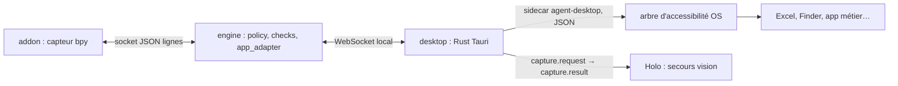

# Accessibilité native — capteur générique hors Blender (proposition)

Statut : proposition, rien n'est implémenté. Relue contre `main` après l'intégration du pointage dévoilé (PR #14). Décision associée : [ADR 0011](../decisions/0011-accessibilite-native.md). Explication non technique : [extension aux apps natives](../extension-apps-natives.md).

## Problème
Pour Blender, l'[add-on](addon.md) est le capteur : il donne l'état exact (bpy) et les rectangles des régions. Depuis le [pointage dévoilé](pointage-et-stt-live.md), `AddonTargetAdapter` ouvre aussi le menu de l'étape (`help.menu_id`) avant que Holo localise sur la région capturée. Pour Excel, Word, Finder, Réglages ou une app métier, il n'y a ni add-on ni adaptateur : il ne reste que la capture de fenêtre (`crop: null`, Linux seulement) + Holo, sans vérification d'état. On ne peut donc pas prouver un ✓ (« pas de ✓ sans check récent »), et sur macOS/Windows la capture échoue explicitement faute de rectangle fourni par un adaptateur.

Les OS exposent déjà l'interface de la plupart des apps aux lecteurs d'écran : un **arbre d'accessibilité** (rôle, nom, valeur, état, rectangle de chaque élément). C'est l'équivalent générique de l'add-on.

| OS | API native |
|---|---|
| macOS | AX API (même permission Accessibilité que celle déjà demandée par desktop) |
| Windows | UI Automation |
| Linux | AT-SPI (bus D-Bus) |

## Brique retenue : agent-desktop
[vercel-labs/agent-desktop](https://github.com/vercel-labs/agent-desktop) : binaire Rust, licence Apache-2.0, CLI à sortie JSON, bibliothèque C et serveur MCP (`agent-desktop mcp`). Aucun modèle embarqué : il observe et agit, la décision reste chez nous. Version examinée : 1.2.0.

| Besoin | Commande agent-desktop |
|---|---|
| Observer | `snapshot --app <app> -i --compact --include-bounds` ; `--skeleton` puis `--root <ref>` pour les apps denses |
| Chercher une cible | `find` (rôle, nom, valeur, texte) |
| Vérifier | `get --property value\|text\|states\|bounds`, `is` (enabled, checked, focused…), `wait --text/--element/--predicate value` |
| Agir | `click`, `set-value`, `type`, `select`, `toggle`, `check`, `expand`, `press` ; livraison sémantique par défaut, entrée physique seulement avec `--headed` |
| Écran | `list-displays` (bornes, facteur d'échelle), `screenshot` d'une fenêtre pour le secours Holo |
| Traçabilité | `--trace <fichier.jsonl>` |

Chaque élément reçoit une référence `@<snapshot_id>:eN` valable pour **ce snapshot uniquement**. Erreurs à traiter explicitement : `APP_NOT_FOUND`, `STALE_REF` (l'interface a changé), `AMBIGUOUS_TARGET` (plusieurs candidats), `POLICY_DENIED`, arbre incomplet (`complete: false`).

## Où ça se branche
Les règles du dépôt sont conservées : engine décide, desktop possède les accès natifs, aucune injection native hors de desktop.



### Point d'insertion existant : `TargetAdapter`
`engine/platform/targets.py` définit déjà la couture : la policy ne connaît aucune app, elle reçoit des capacités optionnelles via `HelpContext` (`reveal_target`, `require_visible`, `shortcut_hint`). Aujourd'hui `EngineRuntime` instancie en dur `AddonTargetAdapter` ; le choix de l'app cible est explicitement « à formaliser » ([pointage dévoilé](pointage-et-stt-live.md)). La proposition s'y loge sans toucher la policy :

```python
class A11yTargetAdapter:                     # engine/platform/targets.py (proposé)
    shortcut_hint: str | None                # propre à l'app ; Blender : "F3"

    async def reveal_target(self, step, context) -> dict | None:
        # 1. a11y.snapshot de l'app cible (desktop) ; 2. résoudre step["help"]["a11y_target"]
        # 3. si cible dans un menu fermé : a11y.action expand/press sur l'ancêtre
        # 4. renvoyer le rectangle écran du conteneur → crop de capture.request
        # None si arbre incomplet / AMBIGUOUS_TARGET → policy garde son repli actuel
```

Ce rectangle alimente le `capture.request` existant : on obtient sur macOS et Windows le recadrage qui n'existe aujourd'hui que via l'add-on (Blender) ou la fenêtre Linux. Holo et ses garde-fous (`visible`, confiance ≥ 0,5, bornes) restent inchangés. Étape suivante optionnelle, si la cible est unique et `complete` : une capacité `locate_target` qui renvoie directement le centre des `bounds` et évite l'appel Holo ; elle demande un petit ajout à la policy, à décider séparément.

| Composant | État sur `main` | Ajout proposé |
|---|---|---|
| `engine/platform/targets.py` | `TargetAdapter`, `AddonTargetAdapter` (ouvre `help.menu_id`, renvoie `screen_rect`) | `A11yTargetAdapter` ; sélection de l'adaptateur par app dans `EngineRuntime` au lieu de l'instanciation en dur |
| `contracts/lesson.schema.json` | `help.menu_id` (Blender), `blender_version` requis | `help.a11y_target` (`role`, `name`, ancêtres, texte attendu) ; `app` + `app_version` : changement de contrat versionné |
| `contracts/desktop-ws.schema.json` | `capture.request` / `capture.result`, `input.result`, `ptt.*`, `audio.chunk`… | messages additifs `a11y.snapshot` / `a11y.get` / `a11y.action` (engine → desktop), `a11y.result` (desktop → engine) avec `snapshot_id`, `complete`, arbre filtré, erreur typée |
| `contracts/commands.schema.json` | `highlight`, `open_menu`, `pointer`, `say`, `input.action`, `stop`, `replay` | rien de nouveau : le dévoilement natif passe par `a11y.action`, le pointeur et la surbrillance restent les mêmes commandes |
| `desktop/src-tauri/` | `input.rs` exige `accessibility` + `blender_focused()` | sidecar `agent-desktop` épinglé (`externalBin`) ; garde « app cible au premier plan » généralisée ; mêmes consentement, verrou, stop prioritaire |
| `engine/platform/` | `Rect`, `Monitor`, `normalized_point()`, `blender_region()` | conversion des `bounds` (points logiques) vers `Rect` ; aucune capture ni injection Python |
| `engine/checks/` | checks bpy | `element_exists`, `element_value`, `element_state` (paramètres fermés, pass/fail/unknown) |
| `prep/ui_map/` | `dump_ui_map`, `operator_menu` (menus Blender) | carte UI d'une app native depuis un snapshot (rôles, noms, chemins) |
| `engine/config.py` | `ENGINE_STT_VOCABULARY` déjà sans liste applicative | vocabulaire fourni par la leçon de l'app native |
| `agent/` | `list_apps` ne renvoie que `blender` | apps dont une leçon est prouvée |
| `bench/` | Holo, Gladia, Jev, add-on | suite `a11y` : succès, latence, taille de contexte arbre vs capture + Holo, taux de secours vision |

## Cibles : décrire, puis résoudre à chaque fois
Conforme à l'[ADR 0010](../decisions/0010-cibles-descriptives.md) : la leçon stocke une description (`role`, `name`, chemin d'ancêtres, texte attendu), jamais une ref ni des pixels. En direct : snapshot frais → `find` → ref unique → action → nouveau snapshot. `STALE_REF` relance une seule résolution ; `AMBIGUOUS_TARGET` ou arbre incomplet passent à Holo.

## Paliers d'aide et « fais-le »
| Palier | Blender (`main`) | App native avec arbre (proposé) |
|---|---|---|
| ② zone | `highlight` de la région + `reveal_target` : ouverture de `help.menu_id` | `reveal_target` : `expand` du menu ancêtre, surbrillance des `bounds` |
| ③ pointeur | Holo sur la région capturée ; refus si `visible=false` ou confiance < 0,5, puis « Utilisez F3 : … » | Holo sur le conteneur recadré, ou centre des `bounds` si `locate_target` est retenu ; repli `say` avec le `shortcut_hint` de l'app |
| « fais-le » | Holo + enigo, puis check | action sémantique (`click`, `set-value`) puis re-snapshot et check |

Une action passe par le même consentement que `input.action`, une seule à la fois, puis vérification sur un nouvel état. Pas de `--headed` par défaut.

## Confidentialité et sécurité
- L'arbre contient du contenu privé (cellules, noms de documents, messages). Filtrer à la sous-arborescence utile (`--root`, `-i`), ne rien envoyer au cloud par défaut, ne pas journaliser les valeurs.
- Les noms et valeurs de l'arbre sont des données non fiables, jamais des instructions pour Holo ou Jev.
- `--screenshot` produit un fichier sensible : désactivé hors debug opt-in.
- Aucun mot de passe ni champ sécurisé automatisé.

## Limites connues
- Blender n'est pas sur le bus d'accessibilité : testé sous Linux, `APP_NOT_FOUND … is not on the accessibility bus`. L'add-on reste obligatoire pour Blender.
- Les interfaces dessinées elles-mêmes (canevas Photoshop, jeux, Blender) exposent peu ou rien : Holo reste nécessaire.
- Les apps Chromium/Electron peuvent demander une activation de l'accessibilité (`--force-electron-a11y`).
- Linux : Ubuntu 24.04+ et session graphique requis par l'outil ; sur la VM Ubuntu 22.04, une app GTK a planté après un snapshot (bogue du pont AT-SPI documenté par l'outil).

## Validation attendue
Recette Mac : Excel (lire une cellule, cliquer un bouton du ruban, vérifier la valeur), Finder, Photoshop (mesurer ce que l'arbre expose), refus puis accord de la permission. Automatisé : fixtures `a11y.result` nominal / vide / erreur, `STALE_REF`, `AMBIGUOUS_TARGET`, arbre incomplet → secours Holo, aucun contenu d'arbre dans les logs. Résultats dans `bench/results/`, sans effacer les échecs.
