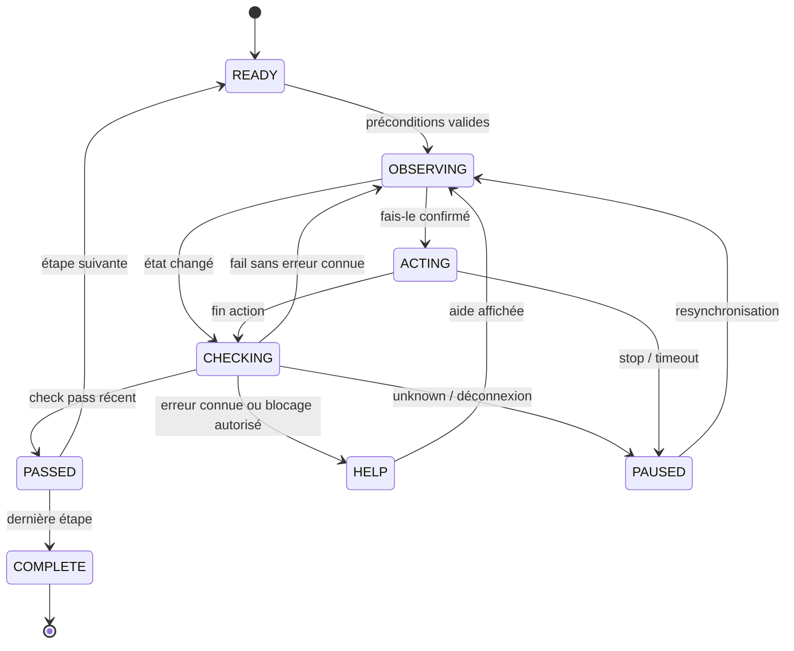

# Engine — cerveau du direct
## Processus et modules
Un processus Python 3.11 asyncio, lancé comme sidecar par desktop. Aucun accès bpy hors de l'add-on ; aucune injection native hors de desktop. Les traitements bloquants doivent quitter la boucle asyncio.
| Module | Entrée | Sortie / responsabilité |
|---|---|---|
| bus | socket JSON lignes, WebSocket, timers | enveloppes validées, files bornées, corrélation et reconnexion |
| lesson | leçon prouvée, événements | étape courante et transitions atomiques |
| checks | snapshot et paramètres typés | pass / fail / unknown, détail et révision de scène |
| policy | progrès, erreur, silence, annulations | intervention autorisée ou abstention |
| learner | défis et aides réellement utilisées | maîtrise par compétence et prochaine révision |
| cache | capture, contexte UI, audio | cible valide ou miss, fichier audio |
| services | requêtes typées | résultats Holo, Jev, Gladia, Linkup, Devin, TTS |
| fallback | délais et disponibilité | règles locales, clavier, texte, pause |
| platform | métadonnées natives de desktop | transformations de coordonnées validées ; pas de capture en Python |
| debug | traces expurgées | page locale, chronologie et métriques |
## Machine d'une étape

## Politique d'aide
Le progrès est un changement pertinent pour le check, pas un simple mouvement de souris. Horloge monotone. Déclencheurs spontanés : erreur corrigeable, 20 s sans progrès, ou 3 undos consécutifs. Intervalle minimal 30 s entre interventions spontanées ; une erreur pendant ce délai reste visible en debug et attend. Une demande explicite reçoit une réponse sans être une intervention spontanée.
Paliers ① indice vocal ; ② zone dessinée dans Blender et menu via wm.call_menu ; ③ pointeur exact Holo ; ④ vidéo de preuve de 3–5 s ou action puis undo contrôlé. Monter d'un palier par blocage, pas quatre d'un coup. « Chut » annule audio et interventions spontanées jusqu'à reprise explicite ; les erreurs restent accessibles en texte. Réussite : ✓ silencieux.
## Cohérence et annulation
Chaque session a session_id, chaque étape step_id et génération. Rejeter une réponse spéculative Jev ou Holo d'une ancienne génération. À la reconnexion : snapshot complet, nouvelle révision UI, puis réévaluation ; ne pas rejouer automatiquement une action mutante sans accusé de réception. Les doublons event_id sont ignorés ; les trous de séquence demandent un snapshot.
## Mémoire apprenant
Stockage local séparé des leçons : skill_id, succès sans aide, palier maximal utilisé, last_review, due_at, unlocked. Un défi réussi sans aide débloque « fais-le » pour cette compétence ; une demande de délégation sur une chose que l'utilisateur ne veut pas apprendre reste toujours possible après confirmation. Algorithme de répétition et intervalles encore à calibrer : aucune durée présentée comme validée.
## Préchargement
Localiser N+1 pendant N, sans ouvrir de menu au détriment de l'utilisateur. Cache logique version × taille de région × échelle UI × cible ; vérifier aussi origine, moniteur, langue, état visible et ui_revision avant affichage. Invalidation lors de déplacement, redimensionnement, changement de menu ou de contexte.
