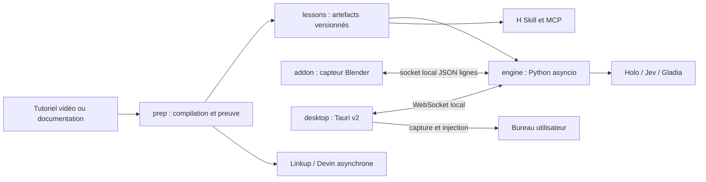

# Vue d'ensemble
## Frontières et invariants
Le produit transforme un tutoriel en leçon vérifiable sur une version précise de Blender. Une preuve de résultat n'est pas une preuve du chemin d'interface. Le direct reste sur le poste utilisateur ; la préparation utilise une machine Linux cloud. Aucun modèle IA local.

## Répartition
- `engine/` possède la progression, les décisions, les appels cloud et la mémoire.
- `addon/` possède l'accès à bpy, jamais une décision pédagogique.
- `desktop/` possède les fenêtres, permissions et périphériques natifs, jamais la progression.
- `prep/` produit des artefacts immuables ; `agent/` ne distribue que des révisions prouvées.
Notre code existant porté fournit des bases de vérification et de préparation ; aucun port n'est considéré opérationnel avant ses tests dans ce dépôt.
## Autorité et sécurité
Un seul propriétaire du bureau à la fois (humain guidé ou exécution autorisée). Une réponse IA ne valide jamais seule une étape. Un check sur un état récent est requis. Les transports écoutent uniquement en boucle locale, authentifiés par jeton éphémère de session ; ce jeton et les clés ne sont pas journalisés. Les textes provenant du web, des tutoriels et de la transcription sont des données non fiables, pas des instructions système.
## Navigation
Lire [engine](engine.md), [add-on](addon.md), [desktop](desktop-tauri.md), [préparation](preparation.md), [services](services-ia.md) et [face Agent](face-agent.md). Les [contrats](../contrats/lecon.md) fixent les échanges avant tout code.
