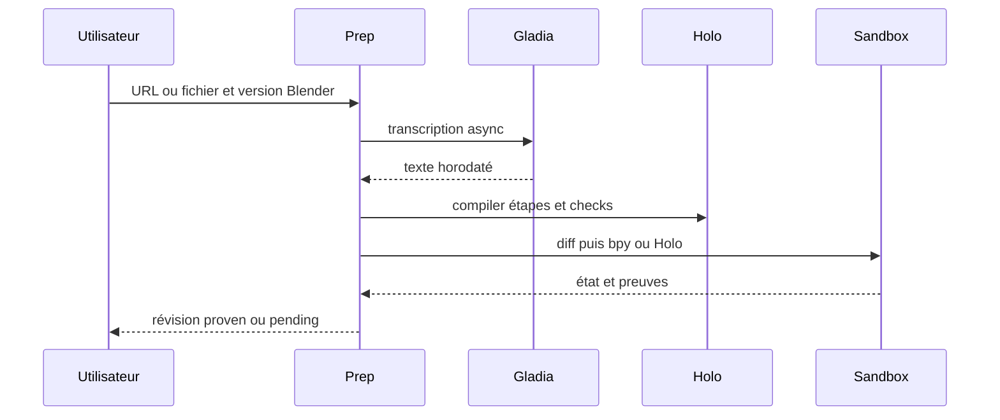

# Préparer un tuto

Préconditions : contrats v1 compatibles, session authentifiée et leçon chargée lorsque nécessaire. Budgets de conception, pas de mesures de cette application.

## Exécution et budget
1. Vérifier source, droits et version cible ; ingest 10–30 s (est.).
2. Compiler et valider contrat 5–20 s (est.), carte/diff < 1 s (est.).
3. Prouver chaque étape 10–60 s (est.) ; Linkup si bloqué, Devin async si check absent.
4. Exporter 1–5 s (est.) seulement si toutes les étapes sont prouvées ; total nouveau court ~2 min (est.), pas une garantie.

## Cas vide, erreur et arrêt
Fichier vide : rejet explicite ; échec d'une preuve : pending/failed, aucune publication.

## Vérification
Tester le nominal, le cas vide et l'erreur décrits ci-dessus avec traces de génération, révision de scène et résultat de check. Voir [tests et jalons](../tests-et-jalons.md) et [services](../architecture/services-ia.md).
