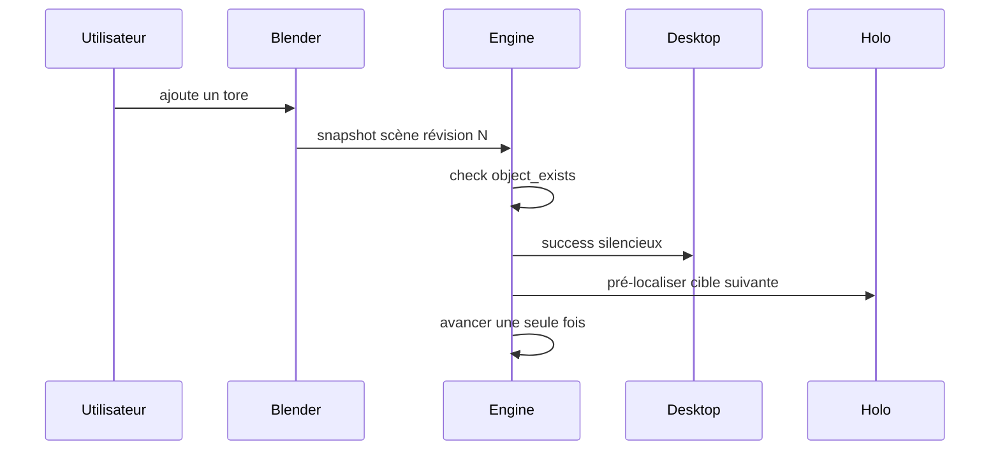

# Étape réussie

Préconditions : contrats v1 compatibles, session authentifiée et leçon chargée lorsque nécessaire. Budgets de conception, pas de mesures de cette application.

## Exécution et budget
1. Observer action en ≤ 100 ms (est.).
2. Évaluer check < 10 ms (est.) sur snapshot récent, sans cloud.
3. Envoyer ✓ et consigne suivante < 50 ms (est.).
4. Précharger N+1 hors chemin critique ; aucun budget Holo dans la réussite.

## Cas vide, erreur et arrêt
Doublon ignoré ; scène vide → fail ; propriété absente → unknown, pas de ✓.

## Vérification
Tester le nominal, le cas vide et l'erreur décrits ci-dessus avec traces de génération, révision de scène et résultat de check. Voir [tests et jalons](../tests-et-jalons.md) et [services](../architecture/services-ia.md).
