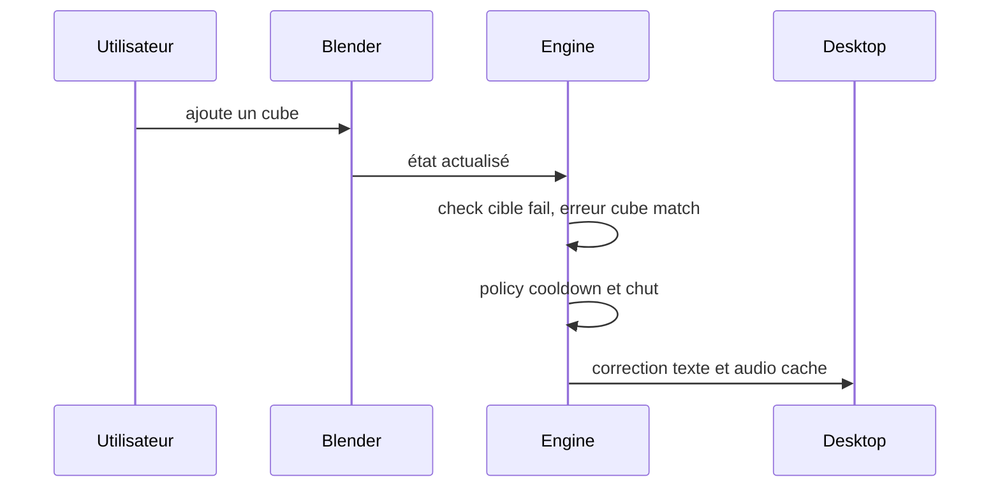

# Erreur corrigeable

Préconditions : contrats v1 compatibles, session authentifiée et leçon chargée lorsque nécessaire. Budgets de conception, pas de mesures de cette application.

## Exécution et budget
1. Détection ≤ 100 ms (est.).
2. Checks < 10 ms (est.) ; Jev seulement si ambigu, délai maximum 800 ms.
3. Audio cache démarrage < 100 ms (est.) ; objectif global < 0,6 s (est.) seulement sans appel lent.
4. Si cooldown 30 s actif : différer intervention spontanée, garder diagnostic visible.

## Cas vide, erreur et arrêt
Ne pas supprimer le cube automatiquement ; absence de match → observer, ne pas inventer une erreur.

## Vérification
Tester le nominal, le cas vide et l'erreur décrits ci-dessus avec traces de génération, révision de scène et résultat de check. Voir [tests et jalons](../tests-et-jalons.md) et [services](../architecture/services-ia.md).
