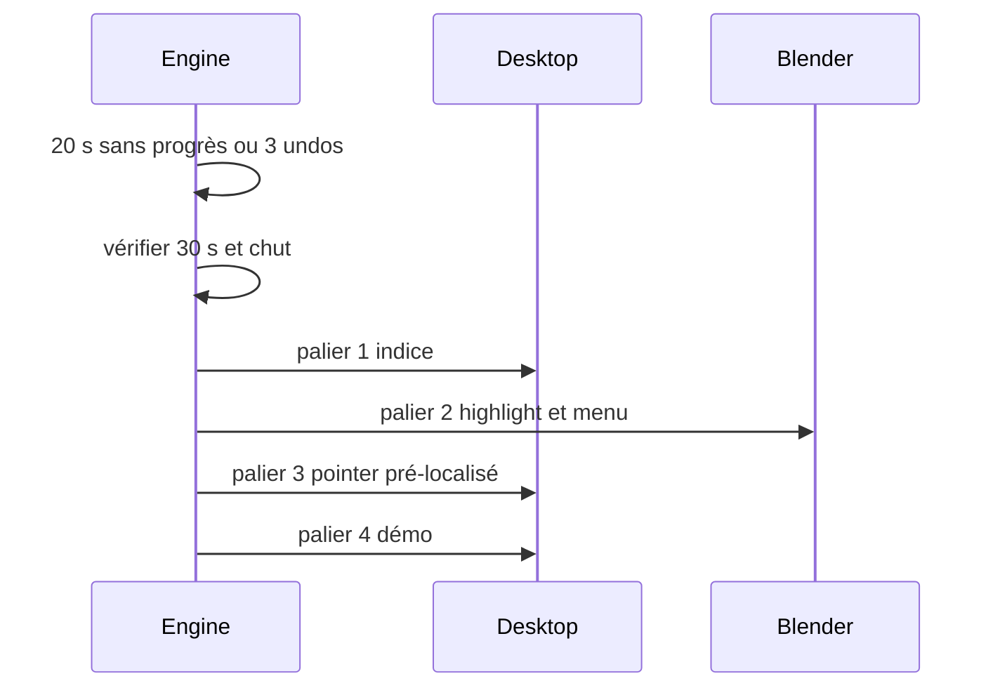

# Blocage et paliers

Préconditions : contrats v1 compatibles, session authentifiée et leçon chargée lorsque nécessaire. Budgets de conception, pas de mesures de cette application.

## Exécution et budget
1. Attendre le seuil de 20 s ou 3 annulations ; ce ne sont pas des latences réseau.
2. À chaque nouveau blocage, respecter 30 s entre interventions ; une seule montée par décision.
3. Dessin zone < 100 ms (est.), point cache < 50 ms (est.) ; sinon localisation 1–5 s (est.), rester au palier 2.
4. Démo 3–5 s ; action puis undo uniquement si checkpoint sûr.

## Cas vide, erreur et arrêt
Chut annule les interventions. Une action pertinente remet le compteur de progrès à zéro ; pas le simple heartbeat.

## Vérification
Tester le nominal, le cas vide et l'erreur décrits ci-dessus avec traces de génération, révision de scène et résultat de check. Voir [tests et jalons](../tests-et-jalons.md) et [services](../architecture/services-ia.md).
