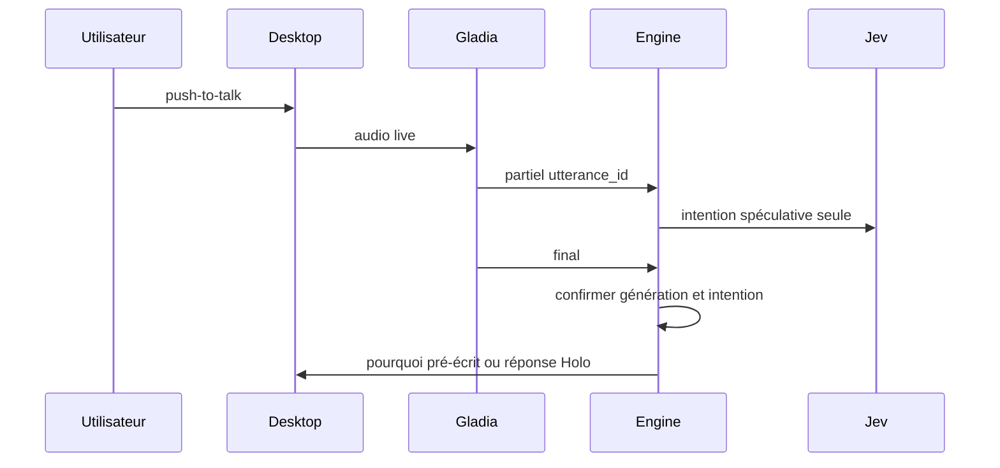

# Question vocale

Préconditions : contrats v1 compatibles, session authentifiée et leçon chargée lorsque nécessaire. Budgets de conception, pas de mesures de cette application.

## Exécution et budget
1. Ouverture micro et envoi < 100 ms (est.) après permission.
2. Gladia partiels 0,3–0,8 s (est.), endpointing défaut 0.05 s ; ce dernier n'est pas la latence totale.
3. Jev : mesures publiques laptop ~460–560 ms, délai applicatif 800 ms ; budget salle à mesurer.
4. Pourquoi cache < 1 s (est.) après intention ; hors script Holo 1,5–3 s (est.) avec phrase d'attente si audio disponible.

## Cas vide, erreur et arrêt
Partiel révisé → annuler spéculation. Ne jamais lancer fais-le sur partiel seul. Silence ou panne micro → clavier.

## Vérification
Tester le nominal, le cas vide et l'erreur décrits ci-dessus avec traces de génération, révision de scène et résultat de check. Voir [tests et jalons](../tests-et-jalons.md) et [services](../architecture/services-ia.md).
