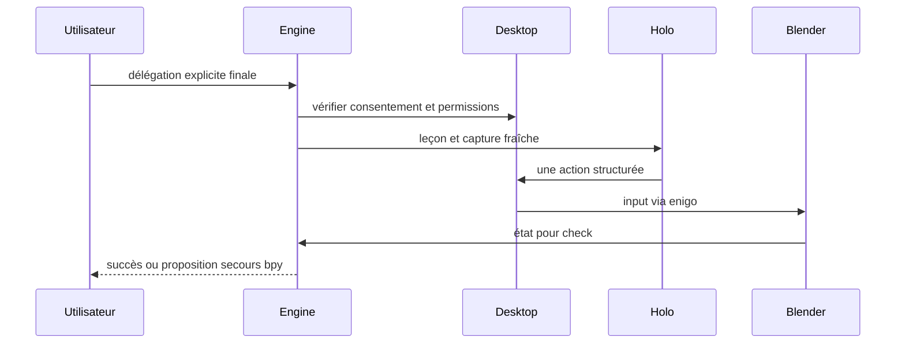

# Fais-le

Préconditions : contrats v1 compatibles, session authentifiée et leçon chargée lorsque nécessaire. Budgets de conception, pas de mesures de cette application.

## Exécution et budget
1. Consentement et verrou < 100 ms (est.) hors temps humain.
2. Capture 50–200 ms (est.) ; tour Holo 1–5 s (est.), timeout 10 s (est.).
3. Injection < 100 ms (est.), attendre nouvel état puis check < 10 ms (est.).
4. Nombre de tours non garanti ; plafond initial 10 tours ou 60 s (est.) puis arrêt et proposition de replay bpy autorisé.

## Cas vide, erreur et arrêt
Focus perdu, stop ou permission absente : arrêter et relâcher touches. Pas d'exécution destructive ni de reprise après coupure sans confirmation.

## Vérification
Tester le nominal, le cas vide et l'erreur décrits ci-dessus avec traces de génération, révision de scène et résultat de check. Voir [tests et jalons](../tests-et-jalons.md) et [services](../architecture/services-ia.md).
