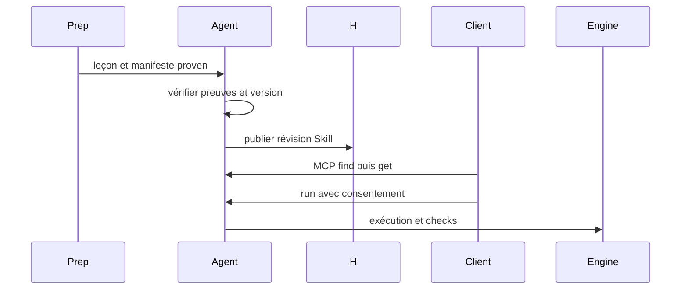

# Export Agent

Préconditions : contrats v1 compatibles, session authentifiée et leçon chargée lorsque nécessaire. Budgets de conception, pas de mesures de cette application.

## Exécution et budget
1. Validation manifeste < 1 s (est.).
2. Publication H 1–10 s (est.) selon API à confirmer.
3. find/get < 100 ms (est.) sur catalogue local ; run suit budget fais-le.
4. report_broken crée ticket 1–5 s (est.), réparation async hors budget.

## Cas vide, erreur et arrêt
Leçon non prouvée ou version absente : refus. Publication distante échouée : catalogue local inchangé, reprise idempotente par révision.

## Vérification
Tester le nominal, le cas vide et l'erreur décrits ci-dessus avec traces de génération, révision de scène et résultat de check. Voir [tests et jalons](../tests-et-jalons.md) et [services](../architecture/services-ia.md).
