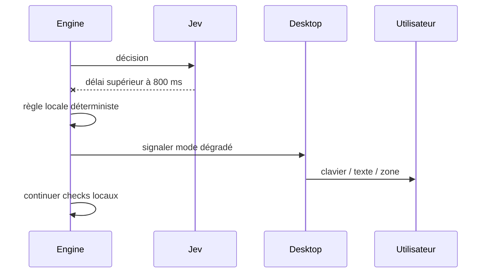

# Mode dégradé

Préconditions : contrats v1 compatibles, session authentifiée et leçon chargée lorsque nécessaire. Budgets de conception, pas de mesures de cette application.

## Exécution et budget
1. Jev : bascule à 800 ms, ignorer réponse tardive.
2. Gladia sans final 2 s après parole (est.) : proposer clavier.
3. Holo sans cible après 5 s (est.) : zone et raccourci, pas de point inventé.
4. Panne générale : checks et leçon cache restent utilisables ; reconnecter avec backoff, pas de boucle de requêtes.

## Cas vide, erreur et arrêt
TTS absent → texte, pas fausse voix. Pas de modèle local caché. Partage réseau ou vidéo de secours signalés comme secours, jamais démo live prétendue.

## Vérification
Tester le nominal, le cas vide et l'erreur décrits ci-dessus avec traces de génération, révision de scène et résultat de check. Voir [tests et jalons](../tests-et-jalons.md) et [services](../architecture/services-ia.md).
