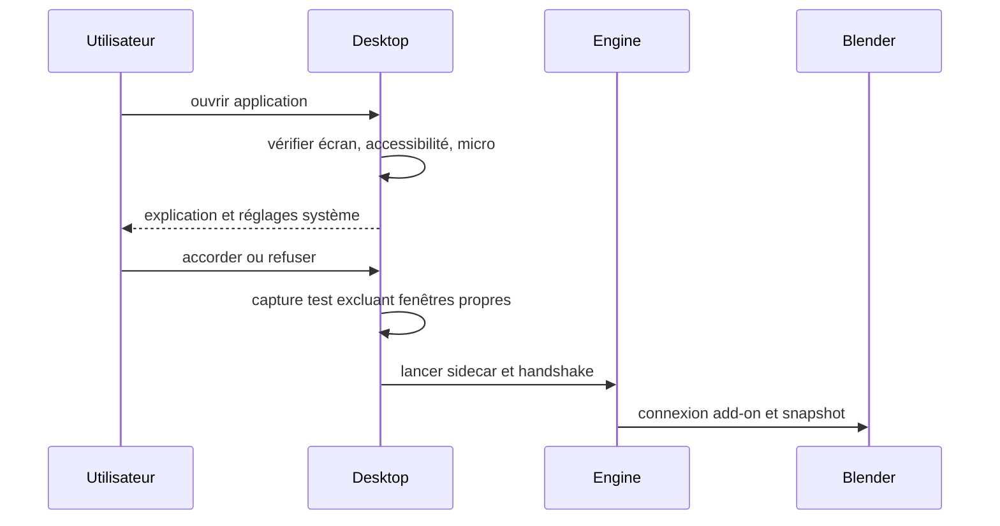

# Premier lancement

Préconditions : contrats v1 compatibles, session authentifiée et leçon chargée lorsque nécessaire. Budgets de conception, pas de mesures de cette application.

## Exécution et budget
1. Vérifications locales < 300 ms (est.), mais temps de réponse utilisateur non borné.
2. Après accord, test capture 50–200 ms (est.) ; tester micro par transcription et injection sur scène de test consentie.
3. Sidecar prêt en 1–3 s (est.) ; handshake/snapshot < 500 ms (est.).
4. Si permission nécessite relancement, expliquer et reprendre la checklist au lancement suivant.

## Cas vide, erreur et arrêt
Refus écran → pas Holo ; refus accessibilité → pas injection ; refus micro → clavier. Checks add-on utilisables indépendamment.

## Vérification
Tester le nominal, le cas vide et l'erreur décrits ci-dessus avec traces de génération, révision de scène et résultat de check. Voir [tests et jalons](../tests-et-jalons.md) et [services](../architecture/services-ia.md).
